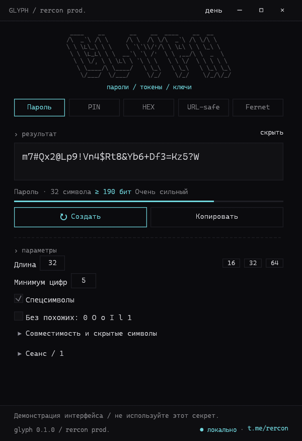
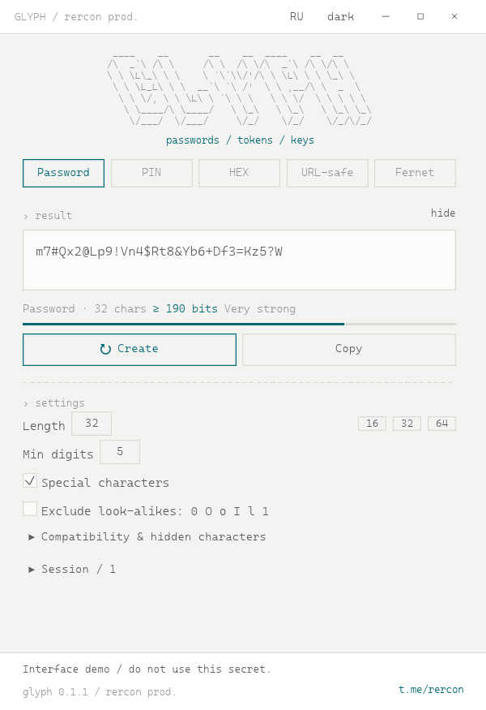
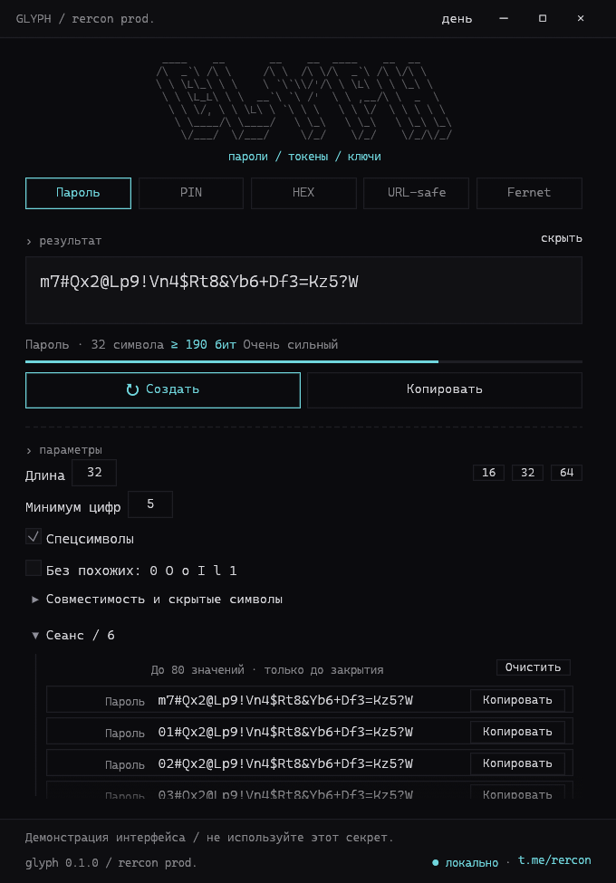
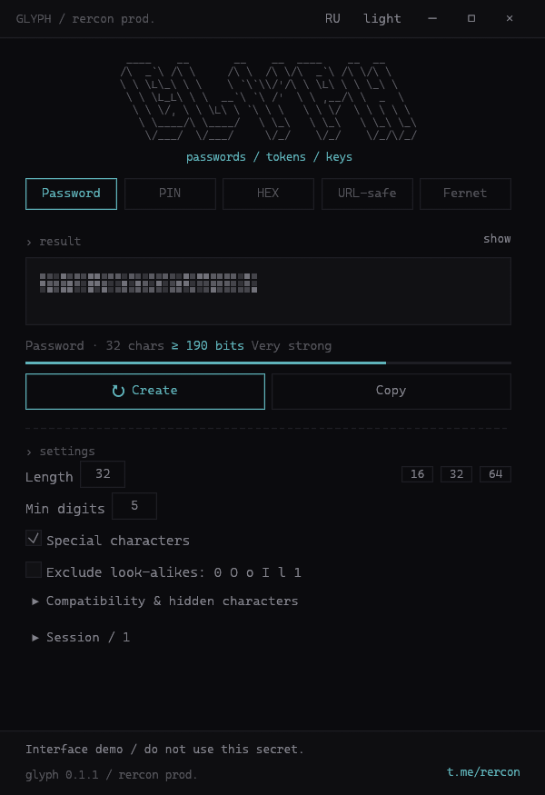

<p align="center">
  
</p>

<h1 align="center">GLYPH</h1>

<p align="center">
  <strong>Passwords, PINs, tokens and Fernet keys.<br>Generated locally, kept in memory, never sent anywhere.</strong>
</p>

<p align="center"><strong>English</strong> · <a href="README.ru.md">Russian</a></p>

<p align="center">
  <a href="https://github.com/RERCON0/GLYPH/releases"></a>
  <a href="LICENSE"></a>
  <a href="https://t.me/rercon"></a>
</p>

<p align="center">
  <a href="#build-for-windows"><strong>Build for Windows</strong></a> ·
  <a href="#quick-start">Quick start</a> ·
  <a href="SECURITY.md">Security</a>
</p>

<table>
  <tr>
    <th>Dark</th>
    <th>Light</th>
  </tr>
  <tr>
    <td width="50%"><a href="docs/screenshot.png"></a></td>
    <td width="50%"><a href="docs/screenshot-light.png"></a></td>
  </tr>
</table>

<p align="center">
  <a href="docs/screenshot-history.png"></a><br>
  <sub>Session history: every generated value can be copied again, exactly as generated.</sub>
</p>

<p align="center">
  <a href="docs/screenshot-masked.png"></a><br>
  <sub>Masked mode: one pixel column per character; it re-settles on every new value.</sub>
</p>

GLYPH is a compact native generator for the credentials you create yourself:
account passwords, numeric PINs, random hex tokens, URL-safe secrets and
Python Fernet keys. It runs as a single portable executable, asks for no
installation and makes no network requests on its own.

The name is the idea: a glyph is a short mark that carries exact meaning.
GLYPH keeps the exact value, including invisible characters, and gives it back
unchanged when you copy it from the session.

## Why GLYPH

- **Local by construction.** Secrets are created with the operating system
  CSPRNG and stay in process memory. There is no account, sync, telemetry,
  update check, history file or log. The only saved preference is the
  interface language in `HKCU\Software\GLYPH`; it contains no secrets.
- **Bias-free randomness.** Character indexes use rejection sampling, and
  shuffling is Fisher–Yates. If the OS random source fails at any stage,
  generation stops instead of falling back to a weaker PRNG.
- **Honest strength figures.** Password entropy is a conservative lower bound
  that accounts for forced digits, a forced special character and reduced
  alphabets. Hidden zero-width characters add nothing to the estimate.
- **A session you can use.** The last 80 values stay available for re-copying
  after the parameters change. Each row copies the exact stored value, not a
  regenerated approximation.
- **Clipboard hygiene.** Copied text is removed after 30 seconds, but only if
  GLYPH still owns the clipboard. A later copy from another application is
  never erased.
- **Small and native.** Rust, egui and glow. No Electron, no bundled browser,
  no runtime to install.

## Features

- **Password:** 1–256 visible characters, minimum digit count, optional special
  characters, exclusion of look-alikes `0 O o I l 1`, presets 16 / 32 / 64.
- **PIN:** digits only, presets 4 / 6 / 8; no hidden characters.
- **HEX:** 1–1024 random bytes as lowercase hex, the equivalent of
  `openssl rand -hex N`.
- **URL-safe:** 1–1024 random bytes as base64url without `=`, the equivalent of
  `secrets.token_urlsafe(N)`.
- **Fernet:** exactly 32 random bytes as a 44-character base64url key with `=`,
  ready for `cryptography.fernet.Fernet`.
- **Hidden characters:** optional U+200B / U+200C / U+200D inside a password,
  with a `\u200B` representation for inspection. The real inserted count is
  shown. Off by default because sites and terminals may strip them.
- **Argon2 compatibility filter:** removes `" ' \ $ ` !` for the legacy
  `PasswordHasher().hash(...)` command shape and disables hidden characters.
  This is a character filter, **not** hashing and **not** general shell escaping.
- **Session:** the last 80 values, newest first, with an individual copy button,
  masking, clearing and hover details (mode, length, entropy, hidden count).
- **Pixel mask:** in masked mode the value is replaced by a pixel-redaction
  strip, not by dots, with one pixel column per visible character (capped by the
  field width). Every new value replays a short settle animation, so a
  regeneration is visible even when the secret itself stays hidden. The pattern
  is derived only from cell positions and time, never from the secret.
- **English / Russian:** the EN/RU button in the title bar switches the whole
  interface and remembers the choice across launches.
- **Clipboard timer:** ownership-aware 30-second clear with a 3-second retry
  window, Windows clipboard-history/cloud opt-out markers, and a clear attempt
  on orderly exit.
- **Themes and DPI:** dark and light Terminal Native themes, per-monitor DPI,
  undecorated window, keyboard shortcuts.

## Quick start

Download `GLYPH.exe` from [Releases](https://github.com/RERCON0/GLYPH/releases), then run it. There is no
installer, no administrator prompt and no first-run network access.

At startup GLYPH immediately creates a password. Switching the mode creates a
result in that format; changing parameters requires **Create** so the
displayed result always matches the visible settings. Copying a stale result is
blocked until you create a new one.

| Shortcut | Action |
|---|---|
| `Ctrl+Enter` | Create a new value |
| `Ctrl+Shift+C` | Copy the current value with the timed clipboard |

> [!NOTE]
> The interface is available in English and Russian. Use the **EN / RU** button
> in the title bar; the choice is saved in `HKCU\Software\GLYPH` and restored on
> the next launch. Russian is the default on a fresh profile.

> [!TIP]
> Use **hide** when someone can see the screen. It masks the current
> result and the session, but copying still returns the real value.

## Modes

| Mode | Output | Equivalent |
|---|---|---|
| Password | 1–256 characters from letters, digits and optional specials | — |
| PIN | Numeric code, digits only | — |
| HEX | 2 characters per random byte, lowercase | `openssl rand -hex N` |
| URL-safe | Base64url without padding | `secrets.token_urlsafe(N)` |
| Fernet | 32 random bytes as base64url with `=` | `Fernet.generate_key()` |

Passwords support a minimum digit count, special characters, `0 O o I l 1`
exclusion, hidden zero-width characters and the Argon2 compatibility filter.
The filter excludes quotes, backslash, dollar, backtick and exclamation mark;
it does not escape arbitrary shell commands.

## Session and clipboard

The session keeps the last 80 generated values **in memory only**, newest
first. It disappears when GLYPH closes; nothing is written to disk.

- **Copy** on a row copies that exact value, including hidden characters. It
  works even after the settings have changed.
- **Clear** clears the history but keeps the current result.
- **hide** replaces the current result with a pixel mask (one column per
  visible character) and every session row with a pixel-style placeholder;
  **Copy** still uses the original value. Creating a new value replays a short
  pixel animation.
- Hover a truncated row to see its mode, visible length, entropy estimate and
  hidden-character count.
- The list occupies the free height under the form and scrolls inside its own
  area. Opening it does not change the form width.

A copied value is scheduled for removal after 30 seconds. GLYPH compares the
Windows clipboard sequence number under the clipboard lock and clears only its
own content. If another application copies something later, the timer reports
that the clipboard was superseded and leaves the other content alone.

## Security

- Randomness comes from `getrandom` (Windows CSPRNG). Index selection is
  unbiased; shuffling uses Fisher–Yates; every random failure aborts generation.
- Primary secret buffers are zeroized when history entries are evicted, when the
  session is cleared and when the process exits normally.
- Clipboard writes set the Windows `CanIncludeInClipboardHistory` and
  `CanUploadToCloudClipboard` opt-out formats. Third-party clipboard managers
  may ignore them.
- GLYPH makes no network requests, creates no files with secrets and writes no
  logs. The only persisted setting is the interface language in
  `HKCU\Software\GLYPH`. The only external action is opening the fixed
  `t.me/rercon` channel in the default browser when you click the footer link;
  no secret or parameter is placed in the URL.

Zeroization and the clipboard timer cover GLYPH's own primary buffers, not
every copy: egui's text layout cache, the GPU/window stack and the clipboard
heap are outside that boundary. GLYPH is not a defence against malware, memory
dumps, screen capture, pagefile remnants or a compromised operating system.

See [SECURITY.md](SECURITY.md) for the threat model and the full list of
limitations.

## Build for Windows

Requirements: Windows 10/11 x64, Rust 1.99.0 with the MSVC toolchain, Visual
Studio Build Tools with C++ and the Windows SDK. The MSVC runtime is linked
statically; the result is a single portable `.exe`.

```powershell
cargo fmt --all -- --check
cargo clippy --all-targets --all-features --locked -- -D warnings
cargo test --all-targets --all-features --locked
cargo build --release --locked --bin glyph
```

The complete verification and packaging flow is:

```powershell
powershell -NoProfile -File scripts/build.ps1
```

It runs formatting, Clippy, all tests and a release build, copies `GLYPH.exe`
to the project root and `dist/`, checks both PE images (x64 GUI, static MSVC
CRT, DPI manifest) and prints the SHA-256. The build also fails if the version
in `Cargo.toml`, `icons/icon.rc` and `icons/app.manifest` disagree.

Screenshots are rendered from the app itself, using fixed demonstration values:

```powershell
cargo run --locked --example snapshot --features preview -- docs/screenshot.png dark password 480 700 en
cargo run --locked --example snapshot --features preview -- docs/screenshot-history.png dark password 544 780 history 6 en
cargo run --locked --example snapshot --features preview -- docs/screenshot-masked.png dark password 480 700 masked en
```

## License

[GNU GPL v3.0 or later](LICENSE). Bundled font:
[Cascadia Mono / SIL OFL notice](fonts/OFL-notice.txt).

[Author's Telegram](https://t.me/rercon) · [Source](https://github.com/RERCON0/GLYPH)
