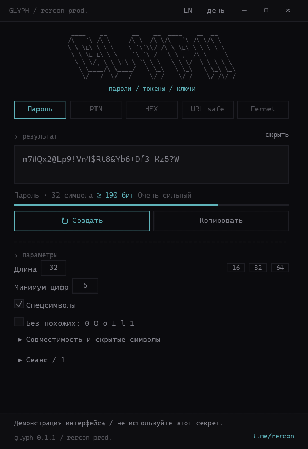
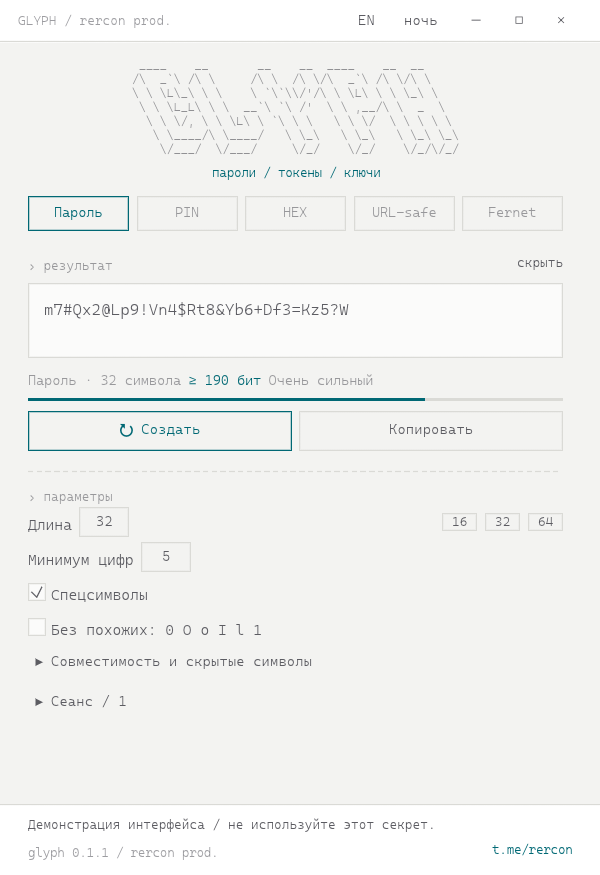
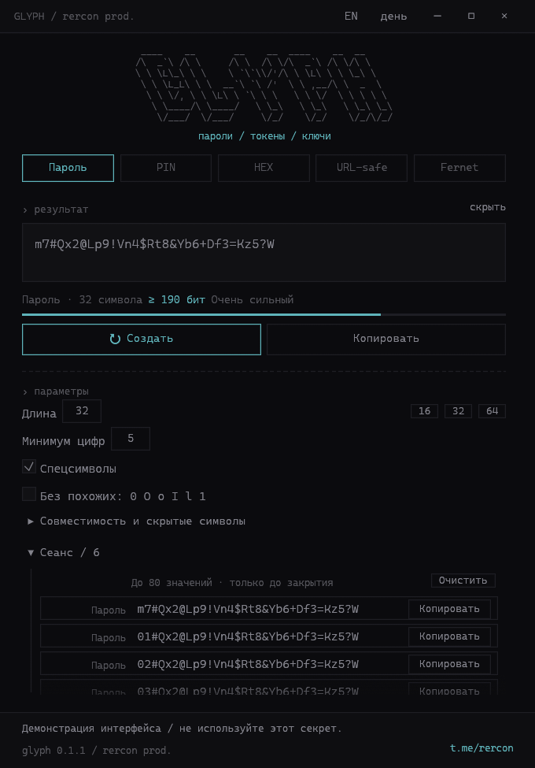
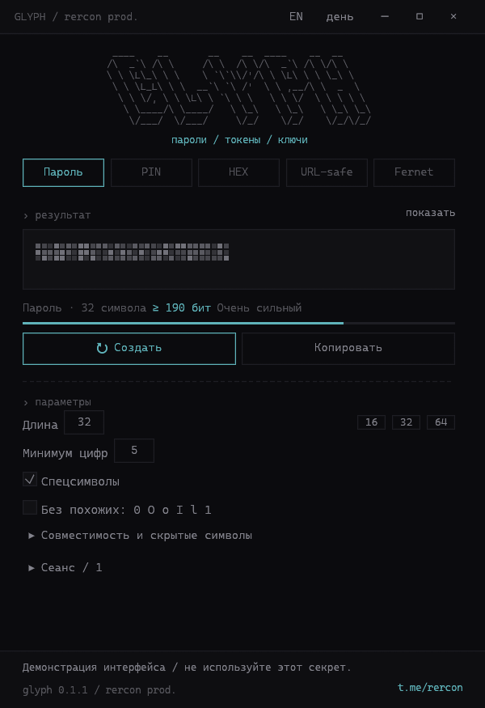

<p align="center">
  
</p>

<h1 align="center">GLYPH</h1>

<p align="center">
  <strong>Пароли, PIN, токены и ключи Fernet.<br>Создаются локально, живут в памяти, никуда не отправляются.</strong>
</p>

<p align="center"><a href="README.md">English</a> · <strong>Русский</strong></p>

<p align="center">
  <a href="LICENSE"></a>
  <a href="https://t.me/rercon"></a>
</p>

<p align="center">
  <a href="#сборка-для-windows"><strong>Сборка для Windows</strong></a> ·
  <a href="#быстрый-старт">Быстрый старт</a> ·
  <a href="SECURITY.md">Безопасность</a>
</p>

<table>
  <tr>
    <th>Тёмная тема</th>
    <th>Светлая тема</th>
  </tr>
  <tr>
    <td width="50%"><a href="docs/screenshot-ru.png"></a></td>
    <td width="50%"><a href="docs/screenshot-light-ru.png"></a></td>
  </tr>
</table>

<p align="center">
  <a href="docs/screenshot-history-ru.png"></a><br>
  <sub>Сеанс: каждое значение можно скопировать повторно — ровно таким, каким оно было создано.</sub>
</p>

<p align="center">
  <a href="docs/screenshot-masked-ru.png"></a><br>
  <sub>Скрытый режим: по пиксельной колонке на символ; плашка заново «оседает» при каждом новом значении.</sub>
</p>

GLYPH — компактный нативный генератор для учётных данных, которые вы создаёте
сами: паролей, цифровых PIN, случайных hex-токенов, URL-safe секретов и ключей
Python Fernet. Это один переносимый `.exe`: без установки, без обращений к сети
и без фоновых служб.

Название — это идея: глиф несёт точное значение. GLYPH сохраняет значение
целиком, включая невидимые символы, и возвращает его при копировании без
изменений.

## Почему GLYPH

- **Локальность по устройству.** Секреты создаются системным CSPRNG и остаются
  в памяти процесса. Нет аккаунта, синхронизации, телеметрии, проверки
  обновлений, файла истории и логов. Единственная сохраняемая настройка — язык
  интерфейса в `HKCU\Software\GLYPH`; секретов в ней нет.
- **Случайность без смещения.** Индексы выбираются rejection sampling,
  перемешивание — Fisher–Yates. Отказ системного источника случайности на любом
  шаге прекращает генерацию: слабого запасного PRNG нет.
- **Честная оценка стойкости.** Для пароля показывается консервативная нижняя
  оценка энтропии с учётом обязательных цифр, обязательного спецсимвола и
  сокращённых алфавитов. Скрытые символы нулевой ширины её не увеличивают.
- **Рабочий сеанс.** Последние 80 значений остаются доступными для повторного
  копирования даже после изменения параметров. Каждая строка копирует точное
  сохранённое значение, а не результат повторной генерации.
- **Гигиена буфера обмена.** Скопированный текст удаляется через 30 секунд, но
  только если в буфере всё ещё содержимое GLYPH. Более поздняя копия из другого
  приложения не стирается.
- **Мало и нативно.** Rust, egui и glow. Без Electron, встроенного браузера и
  устанавливаемого рантайма.

## Возможности

- **Пароль:** 1–256 видимых символов, минимум цифр, спецсимволы, исключение
  похожих `0 O o I l 1`, пресеты 16 / 32 / 64.
- **PIN:** только цифры, пресеты 4 / 6 / 8; скрытые символы не добавляются.
- **HEX:** 1–1024 случайных байта в lowercase hex, аналог `openssl rand -hex N`.
- **URL-safe:** 1–1024 случайных байта в base64url без `=`, аналог
  `secrets.token_urlsafe(N)`.
- **Fernet:** ровно 32 случайных байта в base64url с `=`, 44 символа — готовый
  ключ для `cryptography.fernet.Fernet`.
- **Скрытые символы:** U+200B / U+200C / U+200D внутри пароля, с просмотром
  `\u200B`-представления. Показывается реально вставленное количество. По
  умолчанию выключены: сайты и терминалы могут их удалить.
- **Совместимость Argon2:** фильтр для прежней команды
  `PasswordHasher().hash(...)` исключает `" ' \ $ ` !` и отключает скрытые
  символы. Это фильтр символов, **не** хеширование и **не** универсальное
  экранирование shell.
- **Сеанс:** последние 80 значений, новые сверху, с отдельной кнопкой
  копирования, маскировкой, очисткой и подсказкой (режим, длина, энтропия,
  число скрытых символов).
- **Пиксельная маска:** в скрытом режиме значение заменяется пиксельной
  плашкой, а не точками, — по одной колонке на каждый видимый символ (с
  ограничением по ширине поля). Каждое новое значение проигрывает короткую
  анимацию «оседания» пикселей — пересоздание видно, даже когда сам секрет
  скрыт. Рисунок зависит только от позиций ячеек и времени, но не от секрета.
- **English / Русский:** кнопка EN/RU в заголовке переключает весь интерфейс и
  запоминает выбор между запусками.
- **Таймер буфера:** очистка через 30 секунд с проверкой владения и повторными
  попытками до 3 секунд, маркеры запрета истории и облачной синхронизации
  Windows, попытка очистки при штатном выходе.
- **Темы и DPI:** тёмная и светлая Terminal Native, per-monitor DPI,
  недекорированное окно, горячие клавиши.

## Быстрый старт

Скачайте `GLYPH.exe` в разделе [Releases](https://github.com/RERCON0/GLYPH/releases) и запустите. Установка,
права администратора и сеть при первом запуске не нужны.

При старте сразу создаётся пароль. Переключение режима создаёт результат в этом
формате; изменение параметров применяется кнопкой **Создать**, чтобы показанное
значение всегда соответствовало видимым настройкам. Копирование устаревшего
результата заблокировано до создания нового.

> [!NOTE]
> Интерфейс доступен на русском и английском. Кнопка **EN / RU** в заголовке
> переключает язык; выбор сохраняется в `HKCU\Software\GLYPH` и восстанавливается
> при следующем запуске. На чистом профиле язык русский.

| Сочетание | Действие |
|---|---|
| `Ctrl+Enter` | Создать новое значение |
| `Ctrl+Shift+C` | Скопировать текущее с таймером очистки |

> [!TIP]
> Кнопка **Скрыть** маскирует текущий результат и сеанс, если экран видит кто-то
> ещё. Копирование при этом по-прежнему возвращает настоящее значение.

## Режимы

| Режим | Результат | Аналог |
|---|---|---|
| Пароль | 1–256 символов из букв, цифр и спецсимволов | — |
| PIN | Цифровой код, только цифры | — |
| HEX | 2 символа на случайный байт, lowercase | `openssl rand -hex N` |
| URL-safe | Base64url без выравнивания | `secrets.token_urlsafe(N)` |
| Fernet | 32 случайных байта в base64url с `=` | `Fernet.generate_key()` |

Для пароля доступны минимум цифр, спецсимволы, исключение `0 O o I l 1`,
скрытые символы нулевой ширины и фильтр совместимости с Argon2. Фильтр убирает
кавычки, обратную косую черту, доллар, обратный апостроф и восклицательный знак;
произвольные shell-команды он не экранирует.

## Сеанс и буфер обмена

Сеанс хранит последние 80 значений **только в памяти**, новые сверху. При
закрытии GLYPH он исчезает; на диск ничего не пишется.

- **Копировать** в строке копирует именно это значение, включая скрытые
  символы. Кнопка работает и после изменения параметров.
- **Очистить** удаляет историю, не меняя текущий результат.
- **Скрыть** заменяет текущий результат фиксированной пиксельной плашкой, а
  строки сеанса — пиксельным заполнителем; копирование по-прежнему использует
  исходное значение. Новое значение проигрывает короткую анимацию пикселей.
- При наведении на обрезанную строку видны режим, длина, оценка энтропии и
  число скрытых символов.
- Список занимает свободную высоту под формой и прокручивается внутри своей
  области. Его раскрытие не меняет ширину формы.

Скопированное значение планируется к удалению через 30 секунд. GLYPH сравнивает
sequence number буфера обмена под его блокировкой и очищает только своё
содержимое. Если другое приложение скопирует что-то позже, таймер сообщит, что
буфер был заменён, и не тронет чужое.

## Безопасность

- Случайность предоставляет `getrandom` (Windows CSPRNG). Выбор индексов без
  смещения, перемешивание Fisher–Yates, отказ RNG прекращает генерацию.
- Основные буферы секретов очищаются `zeroize` при вытеснении из истории, при
  очистке сеанса и при штатном завершении процесса.
- При копировании выставляются маркеры Windows
  `CanIncludeInClipboardHistory` и `CanUploadToCloudClipboard`. Сторонние
  менеджеры буфера могут их игнорировать.
- GLYPH не делает сетевых запросов, не создаёт файлов с секретами и не пишет
  логов. Единственная сохраняемая настройка — язык интерфейса в
  `HKCU\Software\GLYPH`. Единственное внешнее действие — открытие фиксированного
  канала `t.me/rercon` в браузере по вашему клику в футере; ни секрет, ни
  параметры в адрес не попадают.

Очистка и таймер покрывают основные буферы самого GLYPH, но не все копии:
кэш раскладки текста egui, графический стек и куча буфера обмена находятся вне
этой границы. GLYPH не защищает от вредоносного ПО, дампов памяти, скриншотов,
остатков в подкачке и скомпрометированной ОС.

Полная модель угроз и ограничения — в [SECURITY.md](SECURITY.md).

## Сборка для Windows

Требования: Windows 10/11 x64, Rust 1.99.0 с MSVC, Visual Studio Build Tools с
C++ и Windows SDK. MSVC CRT линкуется статически; на выходе один переносимый
`.exe`.

```powershell
cargo fmt --all -- --check
cargo clippy --all-targets --all-features --locked -- -D warnings
cargo test --all-targets --all-features --locked
cargo build --release --locked --bin glyph
```

Полная проверка и упаковка:

```powershell
powershell -NoProfile -File scripts/build.ps1
```

Скрипт запускает форматирование, Clippy, все тесты и release-сборку, копирует
`GLYPH.exe` в корень проекта и `dist/`, проверяет оба PE-файла (x64 GUI,
статический MSVC CRT, манифест DPI) и печатает SHA-256. Сборка также падает,
если версии в `Cargo.toml`, `icons/icon.rc` и `icons/app.manifest` разошлись.

Снимки интерфейса делаются самим приложением на фиксированных демонстрационных
значениях:

```powershell
cargo run --locked --example snapshot --features preview -- docs/screenshot-ru.png dark password 480 700 ru
cargo run --locked --example snapshot --features preview -- docs/screenshot-history-ru.png dark password 544 780 history 6 ru
cargo run --locked --example snapshot --features preview -- docs/screenshot-masked-ru.png dark password 480 700 masked ru
```

## Лицензии

Код — [GNU GPL v3.0 or later](LICENSE). Шрифт:
[Cascadia Mono / SIL OFL](fonts/OFL-notice.txt).

[Telegram автора](https://t.me/rercon) · [Исходники](https://github.com/RERCON0/GLYPH)
